<!--
  AKSHAT // BUILDING INTELLIGENCE
  Theme: midnight / electric cyan / ultraviolet
  Assets: assets/hero.svg is original and lives in this repository.
  Dynamic contribution artwork is produced by .github/workflows/profile-art.yml.
  After adding the files, run the workflow once from GitHub Actions to create the output branch.
-->

  

  
  
  

   

  

  

    <b>Computer Science '28</b> &nbsp;·&nbsp; <b>AI / ML & Computer Vision</b> &nbsp;·&nbsp; <b>Open Source Contributor</b> 
    Based in Delhi NCR, India · Former Data Science Intern · Building and learning in public
  

---

### `01 / about.me`

I'm **Akshat**, a computer science undergraduate who likes turning ambitious ideas into reproducible, useful software. My playground spans **computer vision, deep learning, NLP, retrieval systems, and backend engineering**. I care about good experiments, inspectable results, and the unglamorous engineering that makes a demo dependable.

- 🧪 **Currently exploring:** multimodal AI, reliable vision pipelines, LLM systems, and Python backends.
- 🗺️ **Beyond GitHub:** 41,000+ **OpenStreetMap map edits**, helping improve the real-world map.
- 🛠️ **In the open:** contributing fixes and learning from maintainers across projects such as **Kornia** and **Wagtail**.
- 🎯 **Next chapter:** software engineering / AI engineering internships and more meaningful open-source contributions.

### `02 / things.i've.built`

> Different domains. Same obsession: make the output explainable, testable, and useful.

| Project | What I'm engineering |
| :-- | :-- |
| 🌕 **[LunarCV](https://github.com/AkshatPal2007/LunarCV)** | Scientific image registration for **Chandrayaan-2 OHRC and lunar reference imagery**. Real-pixel matches, confidence diagnostics, and strict quality gates; **development-stage, not independently validated**. |
| 🥗 **[CodeDiet](https://github.com/AkshatPal2007/CodeDiet)** | A Python static-analysis CLI that flags structural bloat and unnecessary wrappers in AI-assisted code, separating verifiable findings from review suggestions. |
| 📚 **[DocuMind AI](https://github.com/AkshatPal2007/DocuMind-AI)** | Cited document Q&A with **PostgreSQL full-text search + pgvector**, evidence-based answers, and conservative abstention when retrieval is insufficient. |
| 🎙️ **[VeriVox](https://github.com/AkshatPal2007/VeriVox)** | Spoofed-speech detection using **Mel spectrograms and a Conformer-based model**, built around the ASVspoof dataset. |
| 😼 **[MeowFace](https://github.com/AkshatPal2007/MeowFace)** | Real-time facial-expression recognition that mirrors your mood with a cat, using **CNNs and OpenCV**. AI, but make it playful. |
| 📢 **[NiyamPulse](https://github.com/AkshatPal2007/NiyamPulse-LIVE)** | Evidence-first exam notification intelligence, with verified source changes, multilingual summaries, and human review before alerts. |

<b>More from my workbench</b> · desktop apps, tools, and experiments

 

- 🎵 [Voxi](https://github.com/AkshatPal2007/Voxi) — a Windows music companion with synchronized, animated lyrics, built with Tauri, Rust and TypeScript.
- 🧠 [Neural Network from Scratch](https://github.com/AkshatPal2007/Neural-Network-from-scratch) — working through the fundamentals under the hood.
- 🔬 [FineTuning LM](https://github.com/AkshatPal2007/FineTuning_LM) · [LoRA with PyTorch](https://github.com/AkshatPal2007/LoRA-with-PyTorch) — language-model engineering experiments.

### `03 / toolkit` 

  <b>Languages · ML · Computer Vision</b>  
  
    
  <b>APIs · Data · Systems · Developer Tools</b>  
  

Also working with NumPy, SciPy, NLTK, OpenStreetMap, SQL, Jupyter, GitHub Actions and CUDA-enabled workflows.

### `04 / open.source` 

I enjoy the full contribution loop: **reproduce a bug → understand the underlying behavior → write a focused fix → prove it with tests → respond to review**.

**Repositories I've contributed to / explored:** [Kornia](https://github.com/kornia/kornia) · [Wagtail](https://github.com/wagtail/wagtail) · [OpenStreetMap iD](https://github.com/openstreetmap/iD)

**Outside code:** I also help improve the real-world map through OpenStreetMap. 

### `05 / github.telemetry`

  
  
   
  

### `06 / contribution.circuit`

<!-- The images below appear after running .github/workflows/profile-art.yml for the first time. -->

  <picture>
    <source media="(prefers-color-scheme: dark)" srcset="https://raw.githubusercontent.com/AkshatPal2007/AkshatPal2007/output/contribution-fx-dark.svg" />
    
  </picture>

<b>🐍 Switch to classic mode: contribution snake</b>

 

  <picture>
    <source media="(prefers-color-scheme: dark)" srcset="https://raw.githubusercontent.com/AkshatPal2007/AkshatPal2007/output/github-snake-dark.svg" />
    
  </picture>

---

  <b>Have a hard problem involving ML, vision, backend engineering, or open source?</b> 
  I like talking to people who build things and care whether they work.  
  <a href="https://akshatpal.in"><b>Explore my work</b></a> &nbsp;·&nbsp;
  <a href="https://www.linkedin.com/in/akshatpal2007/"><b>Connect</b></a> &nbsp;·&nbsp;
  <a href="mailto:akshatpc12345@gmail.com"><b>Collaborate</b></a>
    
  Designed with curiosity. Maintained with commits.

